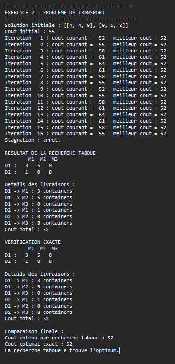
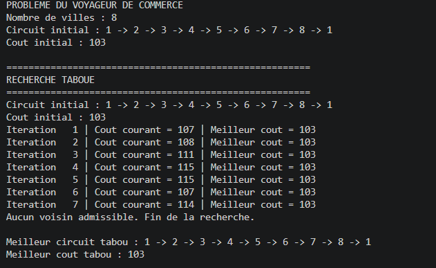
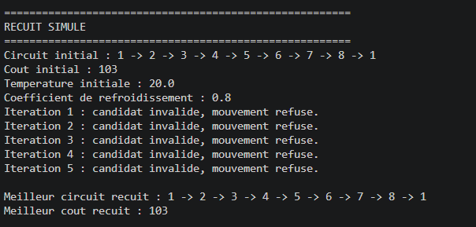
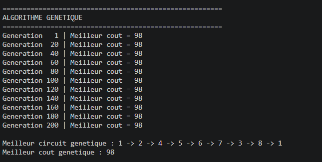
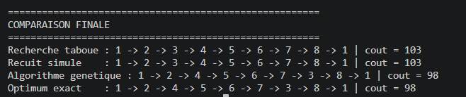

# TD : Métaheuristiques

## Introduction
Dans ce TD, nous avons étudié deux problèmes d'optimisation : le problème de transport et le problème du voyageur de commerce. Nous avons utilisé différentes méthodes pour chercher les meilleures solutions.

## Exercice 2 : Problème de transport
Nous avons appliqué la recherche taboue pour minimiser le coût total du transport entre les dépôts et les magasins.

### Résultat

## Exercice 3 : Voyageur de commerce
Nous avons appliqué trois méthodes : la recherche taboue, le recuit simulé et l'algorithme génétique, afin de trouver un circuit de coût minimal.

### Résultats

**Recherche taboue**

**Recuit simulé**

**Algorithme génétique**

**Solution exacte**

## Conclusion
Ce TD nous a permis de comprendre le fonctionnement de plusieurs méthodes d'optimisation et de comparer les solutions obtenues.